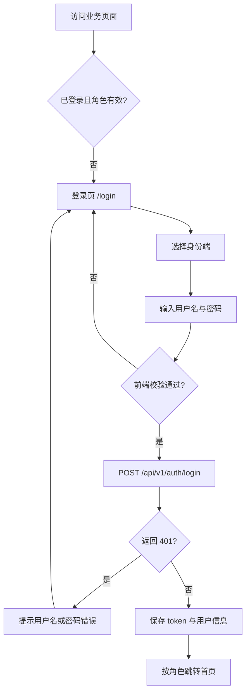
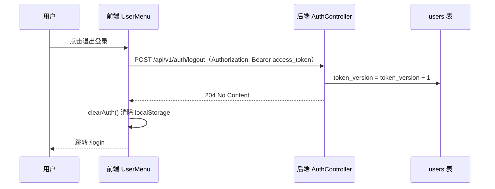

# 三端账号体系 · UI 与 API 接口设计（补充）

| 项目 | 内容 |
| --- | --- |
| 文档类型 | 设计补充文档（认证模块） |
| 适用范围 | 登录、注册、登出、令牌刷新 |
| 关联代码 | `frontend/src/views/LoginView.vue`、`frontend/src/views/RegisterView.vue`、`frontend/src/components/common/UserMenu.vue`、`backend/src/main/java/com/blue333/ordermgmt/controller/AuthController.java`、`backend/src/main/java/com/blue333/ordermgmt/service/AuthService.java` |
| 关联提交 | `2ac67c0` feat(auth): 增加三端身份选择与账号注册；登出功能 |
| 说明 | 本文档补充认证模块的 UI 与 API 设计细节，不替代 `PRD.md` 与 `GLOSSARY.md` |

---

## 1. 背景与目标

系统按角色分为三端：客户经理端（AM）、业务负责人端（BO）、设计师端（DS）。原实现只提供固定演示账号登录，本次补充：

1. 登录前必须选择身份端，形成「三端分离」的入口体验；
2. 每端支持自助注册账号，注册后回到登录页登录；
3. 登录后提供全局用户菜单与退出登录，服务端令牌同步失效。

设计原则：

- 前端只做 UX 级门禁，权限判定仍由后端 Spring Security 与方法级 RBAC 强制执行；
- 所有接口统一走 `/api/v1` 前缀，响应统一包裹；
- 前端同时保留 Mock 适配器，后续可离线演示。

---

## 2. 角色与身份端对照

| 身份端 | `RoleType` | 角色名称 | 登录后默认首页 | 主要职责 |
| --- | --- | --- | --- | --- |
| 客户经理端 | `AM` | 客户经理 | `/am/orders` | 登记订单、提交审阅、发起客户评审 |
| 业务负责人端 | `BO` | 业务负责人 | `/bo/review` | 审阅订单、派发任务、异常与归档管理 |
| 设计师端 | `DS` | 设计师 | `/ds/tasks` | 接收任务、上传设计版本、处理反馈 |

后端角色数据来自 `roles` 表（`role_type` 唯一），用户与角色通过 `user_roles` 关联。

---

## 3. UI 设计

### 3.1 登录页 `/login`

布局：单卡片居中（宽 380px），自上而下为

1. 系统标题「宣传物料订单管控系统」；
2. 副标题「请选择身份端后登录」；
3. 身份端选择区：三个等宽卡片（客户经理端 / 业务负责人端 / 设计师端），卡片含名称与一句职责说明；
4. 用户名、密码输入框；
5. 反馈区（注册成功提示 / 登录错误提示）；
6. 「登录」主按钮；
7. 「还没有账号？注册新账号」链接；
8. 演示账号提示区（三个演示账号及统一密码 `demo123`）。

交互规则：

| 场景 | 行为 |
| --- | --- |
| 未选择身份端即提交 | 身份端卡片区显示红框，提示「请先选择身份端」 |
| 用户名为空 | 提示「请输入用户名」 |
| 密码为空或少于 4 位 | 提示「请输入密码」/「密码至少 4 位」 |
| 登录成功 | 保存 `access_token`、`refresh_token`、`current_user` 到 localStorage，按 `user.roles[0]` 跳转默认首页；若 URL 带 `redirect` 参数则优先跳转该地址 |
| 登录返回 401 | 展示后端 `message`，缺省文案「用户名或密码错误」 |
| 登录进行中 | 按钮文案变为「登录中…」并禁用 |
| 注册成功返回 | URL 携带 `registered=1` 时展示「注册成功，请使用新账号登录」，并预填用户名与身份端 |

路由参数：

| 参数 | 来源 | 用途 |
| --- | --- | --- |
| `redirect` | 路由守卫写入 | 登录后回到原目标页 |
| `registered` | 注册成功跳转写入 | 展示注册成功提示 |
| `username` | 注册成功跳转写入 | 预填用户名 |
| `role` | 注册成功跳转写入 | 预选身份端 |

登录状态流转：



已登录用户访问 `/login` 或 `/register` 时，路由守卫会按 `primaryRole` 重定向到对应首页。

### 3.2 注册页 `/register`

布局：与登录页同风格单卡片，字段顺序为

1. 身份端选择卡片（必选）；
2. 姓名；
3. 用户名；
4. 密码；
5. 确认密码；
6. 错误提示区；
7. 「注册」主按钮；
8. 「已有账号？返回登录」链接。

校验规则（前端）：

| 字段 | 规则 | 失败提示 |
| --- | --- | --- |
| 身份端 | 必选 | 请选择要注册的身份端 |
| 姓名 | 非空 | 请输入姓名 |
| 用户名 | 3~20 位，仅字母、数字、下划线 | 用户名需为 3~20 位字母、数字或下划线 |
| 密码 | 至少 4 位 | 密码至少 4 位 |
| 确认密码 | 与密码一致 | 两次输入的密码不一致 |

提交成功后跳转 `/login?registered=1&username=<用户名>&role=<身份端>`，不在注册页自动登录。

服务端错误映射：

| HTTP 状态 | 场景 | 页面表现 |
| --- | --- | --- |
| 409 | 用户名已存在 | 展示后端 `message`「用户名已存在」 |
| 400 | 参数缺失 / 格式不合法 / 身份端非法 | 展示后端 `message` |
| 422 | 角色数据未初始化 | 展示后端 `message` |

### 3.3 全局用户菜单与登出

位置：`App.vue` 顶部全局条，仅当 `isLoggedIn && primaryRole` 为真时渲染，登录页与注册页不显示。

内容：系统名称（左）、姓名与身份端标签（右）、「退出登录」按钮。

登出流程：



约定：

- 无论登出接口成功或失败（令牌过期、网络异常），前端都会清除本地会话并跳转登录页；
- 登出后旧 `refresh_token` 因 `token_version` 变化而失效，再次刷新返回 401；
- 登出按钮请求期间文案为「退出中…」并禁用，避免重复提交。

### 3.4 视觉规范（本次新增部分）

| 元素 | 样式 |
| --- | --- |
| 页面背景 | `#f5f7fa` |
| 卡片 | 白底、圆角 8px、`box-shadow: 0 2px 12px rgba(0,0,0,.08)` |
| 主色 | `#409eff` |
| 错误色 | `#f56c6c`（错误提示底色 `#fef0f0`） |
| 身份端选中态 | 边框与文字 `#409eff`，背景 `#ecf5ff` |
| 全局顶栏 | 白底、下边框 `#ebeef5`、左右内边距 24px |

---

## 4. API 设计

### 4.1 通用约定

| 项 | 约定 |
| --- | --- |
| Base URL | `/api/v1` |
| 请求格式 | `application/json; charset=utf-8` |
| 鉴权头 | `Authorization: Bearer <access_token>` |
| 成功包裹 | `{ "data": ... }`，分页列表额外带 `pagination` |
| 错误包裹 | `{ "code": "...", "message": "...", "detail": "..." }`，`detail` 可省略 |
| 免鉴权路径 | `/api/v1/auth/**`、`/actuator/health/**` |
| 令牌类型 | 访问令牌 30 分钟，刷新令牌 7 天（可由环境变量覆盖） |

错误码生成规则：业务异常通过 `ResponseStatusException` 抛出时，`code` 取对应 HTTP 状态名（如 `BAD_REQUEST`、`CONFLICT`、`UNAUTHORIZED`、`UNPROCESSABLE_ENTITY`）。

### 4.2 登录 `POST /api/v1/auth/login`

请求体：

| 字段 | 类型 | 必填 | 说明 |
| --- | --- | --- | --- |
| `username` | string | 是 | 用户名 |
| `password` | string | 是 | 密码 |

> 前端额外携带 `role`（身份端），后端 `LoginRequest` 不包含该字段，按 Jackson 默认配置忽略，不作为登录校验条件。

请求示例：

```json
{ "username": "ds_demo", "password": "demo123", "role": "DS" }
```

成功响应 `200`：

```json
{
  "data": {
    "access_token": "eyJhbGciOiJIUzI1NiJ9...",
    "refresh_token": "eyJhbGciOiJIUzI1NiJ9...",
    "user": { "id": 3, "username": "ds_demo", "name": "李设计", "roles": ["DS"] }
  }
}
```

失败响应：

| 状态 | 场景 | `message` 示例 |
| --- | --- | --- |
| 400 | 用户名或密码为空 | `Username and password are required` |
| 401 | 账号不存在、密码错误、账号被禁用 | `Invalid username or password` |

### 4.3 注册 `POST /api/v1/auth/register`（S-10，本次新增）

请求体：

| 字段 | 类型 | 必填 | 规则 |
| --- | --- | --- | --- |
| `name` | string | 是 | 非空，去除首尾空格，最长 100 字符 |
| `username` | string | 是 | 3~20 位，仅 `A-Z a-z 0-9 _`，全局唯一 |
| `password` | string | 是 | 至少 4 位；服务端使用 BCrypt 加密存储 |
| `role` | string | 是 | `AM` / `BO` / `DS`，大小写不敏感 |

请求示例：

```json
{ "name": "网页注册测试", "username": "designer_web", "password": "pass1234", "role": "DS" }
```

成功响应 `201`（只返回用户信息，不签发令牌）：

```json
{
  "data": { "id": 6, "username": "designer_web", "name": "网页注册测试", "roles": ["DS"] }
}
```

失败响应：

| 状态 | 场景 | `message` 示例 |
| --- | --- | --- |
| 400 | 任一必填字段为空 | 姓名、用户名、密码和身份端均为必填 |
| 400 | 用户名格式不合法 | 用户名需为 3~20 位字母、数字或下划线 |
| 400 | 密码少于 4 位 | 密码至少 4 位 |
| 400 | 身份端非法 | 身份端不合法，可选值：AM / BO / DS |
| 409 | 用户名已存在 | 用户名已存在 |
| 422 | `roles` 表缺少该身份端 | 所选身份端未配置 |

服务端处理顺序：参数校验 → 用户名查重 → 角色查询 → 写入 `users` → 写入 `user_roles` → 返回用户信息。整个流程在同一事务内完成。

### 4.4 登出 `POST /api/v1/auth/logout`

请求头：

| 头 | 必填 | 说明 |
| --- | --- | --- |
| `Authorization` | 是 | `Bearer <access_token>` |

请求体：无。

成功响应 `204 No Content`，无响应体。

失败响应：

| 状态 | 场景 | `message` |
| --- | --- | --- |
| 401 | 缺少或无法解析 Authorization、令牌对应用户不存在、令牌版本失效 | `Unauthorized` |

服务端行为：解析访问令牌 → 校验 `token_version` → 将该用户 `token_version + 1`，使既有访问令牌与刷新令牌全部失效。

### 4.5 刷新令牌 `POST /api/v1/auth/refresh`

请求体：

| 字段 | 类型 | 必填 |
| --- | --- | --- |
| `refresh_token` | string | 是 |

成功响应 `200`：与登录响应结构一致，返回新的访问令牌与刷新令牌。刷新成功后 `token_version` 递增，旧令牌作废。

失败响应：`400`（缺少刷新令牌）、`401`（令牌无效或版本失效）。

### 4.6 错误码对照

| HTTP | `code` | 含义 | 前端处理 |
| --- | --- | --- | --- |
| 400 | `BAD_REQUEST` | 参数缺失或格式错误 | 在表单内展示 `message` |
| 401 | `UNAUTHORIZED` | 认证失败或令牌失效 | 登录页展示错误；业务页交由拦截器刷新或跳转登录 |
| 403 | `FORBIDDEN` | 角色无权访问 | 路由守卫跳 `/403` |
| 409 | `CONFLICT` | 用户名已存在 | 注册页展示 `message` |
| 422 | `UNPROCESSABLE_ENTITY` | 身份端未配置 | 注册页展示 `message` |

---

## 5. 数据模型（认证相关）

| 表 | 关键字段 | 说明 |
| --- | --- | --- |
| `users` | `id`、`username`（唯一）、`password_hash`、`name`、`email`、`phone`、`enabled`、`token_version` | 注册写入 `username/password_hash/name`，`enabled` 默认 1，`token_version` 默认 0 |
| `roles` | `id`、`role_type`（唯一）、`role_name` | 由 `V2__phase1_seed.sql` 初始化 AM / BO / DS |
| `user_roles` | `user_id`、`role_id`、`assigned_at` | 注册时为每个新用户写入一条记录 |

---

## 6. Mock 与真实后端差异

前端通过 `VITE_USE_MOCK` 决定使用 `mock-adapter` 还是真实后端（`frontend/.env.local`）。

| 能力 | Mock 模式 | 真实后端 |
| --- | --- | --- |
| 登录校验身份端 | 校验账号角色与所选身份端一致，不一致返回 401 `ROLE_MISMATCH` | 不校验 `role` 字段，仅按账号真实角色签发令牌 |
| 注册落库位置 | localStorage（`mock-data-v1`） | MySQL `users` + `user_roles` |
| 注册重复用户名 | 409 `USERNAME_EXISTS` | 409 `CONFLICT`，`message` 为「用户名已存在」 |
| 登出 | 本地清理，接口返回 204 | 服务端递增 `token_version`，旧令牌失效 |
| 刷新令牌 | 返回固定 `mock-new-token` | 校验令牌与 `token_version`，签发新令牌 |

已知差异：真实后端不校验登录时选择的身份端。若用户选错身份端但账号密码正确，登录仍成功并按账号真实角色跳转。若需强制一致，可在登录请求中增加角色校验（后续可选项）。

---

## 7. 安全约束

1. 密码仅在传输层明文（本地演示为 HTTP），服务端使用 BCrypt 加密存储，不返回任何密码字段；
2. 令牌存于 localStorage，前端请求统一由 `http.ts` 拦截器附加 `Authorization` 头；
3. 登出与刷新均依赖 `token_version`，实现服务端主动失效；
4. `/auth/register` 为公开接口，当前未做频率限制；生产环境应增加验证码、限流与邮箱/手机验证；
5. 权限不依赖前端：路由守卫失败时返回 `/403`，真正拦截发生在后端方法级 RBAC。

---

## 8. 验收清单

| 编号 | 场景 | 预期 |
| --- | --- | --- |
| UI-01 | 未选身份端点击登录 | 拦截并提示「请先选择身份端」 |
| UI-02 | 正确账号 + 匹配身份端登录 | 跳转对应端首页 |
| UI-03 | 注册页填写合法信息 | 201 → 登录页携带 `registered=1` 与预填信息 |
| UI-04 | 重复用户名注册 | 409 → 页面展示「用户名已存在」 |
| UI-05 | 已登录访问 `/login` 或 `/register` | 按角色重定向首页 |
| UI-06 | 登录后顶栏 | 显示姓名、身份端标签、退出登录按钮 |
| UI-07 | 点击退出登录 | 跳 `/login`，localStorage 无令牌，刷新仍停留登录页 |
| API-01 | `POST /auth/login` 正确凭据 | 200，返回双令牌与用户信息 |
| API-02 | `POST /auth/register` 新账号 | 201，仅返回用户信息，不含令牌 |
| API-03 | `POST /auth/logout` 携带有效令牌 | 204 |
| API-04 | 登出后使用旧 `refresh_token` | 401 |
| API-05 | 访问 `/api/v1/orders` 且无令牌 | 401 |

---

## 9. 变更记录

| 日期 | 内容 |
| --- | --- |
| 2026-11-05 | 新建文档：补充三端登录、注册、登出、令牌刷新及全局用户菜单的 UI/API 设计 |
