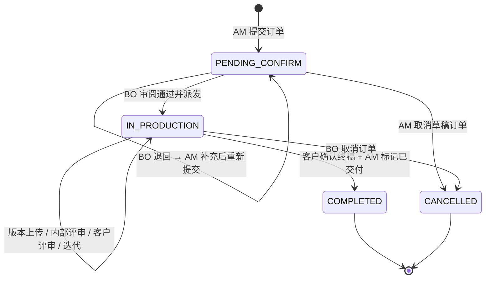
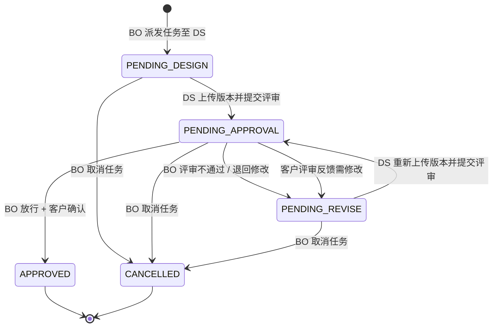

# 单笔宣传物料订单交付管控系统 · 产品需求规格说明书（PRD）

> **文档类型**：产品需求规格说明书
> **产品名称**：单笔宣传物料订单交付管控系统
> **目标用户**：中小广告制作公司
> **版本**：MVP v0.1
> **关联文档**：`docs/01-requirements/USER_STORIES.md`（用户旅程与原子故事分解）
> **日期**：2026-09-18

---

## 目录

1. [系统概述与 MVP 业务边界](#1-系统概述与-mvp-业务边界)
2. [角色与 RBAC 权限矩阵](#2-角色与-rbac-权限矩阵)
3. [订单与物料任务双状态机](#3-订单与物料任务双状态机)
4. [功能模块详细规格与业务规则字典](#4-功能模块详细规格与业务规则字典)
5. [非功能性需求（NFR）](#5-非功能性需求nfr)
6. [显式非目标清单（Out of Scope / Won't Have）](#6-显式非目标清单out-of-scope--wont-have)

---

## 1. 系统概述与 MVP 业务边界

### 1.1 系统定位

本系统是一款面向中小广告制作公司的 **B 端单笔宣传物料订单交付管控平台**。核心模式：

- **标准化流程链路**：从需求登记到客户确认交付的全流程节点化管控，替代传统即时通讯口头沟通。
- **角色权责隔离**：客户经理（AM）、业务负责人（BO）、设计制作人员（DS）三角色各司其职，操作边界清晰、留痕可追溯。
- **设计版本全留痕**：设计稿上传自动编号、历史版本永久留存、版本对比与终稿标识，消除版本混淆。

### 1.2 核心业务痛点与解决路径

| 行业痛点 | 解决路径 |
|---|---|
| 需求传递失真 | 标准化表单 + 需求基线 + 附件归集，需求一次成型 |
| 版本混淆不清 | 自动版本编号 + 历史留痕 + 版本对比 + 终稿标识 |
| 进度分散难追踪 | 我的订单列表 + 看板状态总览，状态实时可见 |
| 权责边界模糊 | 派发到人 + 反馈绑定版本 + 放行 / 确认留痕 |

### 1.3 MVP 业务边界

MVP 聚焦最小可用的"需求—版本—确认"闭环。一个订单从客户经理登记需求开始，经业务负责人审阅派发、设计制作人员执行与版本上传、内部评审放行、客户评审反馈、迭代直至客户确认交付，全程在系统内留痕、可追溯。

#### 1.3.1 本期纳入（MVP 闭环）

| # | 模块 | 核心能力 |
|---|---|---|
| 1 | 订单需求登记 | 标准化表单（物料类型 / 规格 / 场景 / 截止日期）+ 参考素材上传 |
| 2 | 需求基线确认 | 提交前形成可追溯的需求版本 |
| 3 | 任务分派与流转 | 业务负责人审阅、退回、派发、设截止 |
| 4 | 设计版本管理 | 上传自动编号、历史留痕、版本对比 |
| 5 | 进度跟踪 | 我的订单 / 看板状态总览 |
| 6 | 内部评审与放行 | 版本审核、放行至客户评审 |
| 7 | 客户评审与反馈 | 版本级反馈条目化记录 |
| 8 | 客户确认与交付闭环 | 确认留痕、终稿标识、归档 |
| 9 | 站内提醒 | 待办推送、状态变更通知（仅站内） |

#### 1.3.2 暂不纳入（后续迭代）

| # | 模块 | 说明 |
|---|---|---|
| 1 | 合同与财务 | 报价、合同、开票、收款 |
| 2 | 在线设计 | 系统内置设计 / 协作画布工具 |
| 3 | 印刷生产 | 对接印刷厂、生产排程、工单 |
| 4 | 物流配送 | 发货、物流跟踪、签收 |
| 5 | 外部消息通知 | 微信 / 短信 / 邮件等外部渠道推送 |

> **说明**：外部消息通知指对外部渠道（微信 / 短信 / 邮件）的推送；MVP 内**站内提醒**（待办、状态变更）属于闭环内必要能力，予以保留。

### 1.4 系统上下文

```
┌─────────────────────────────────────────────────────┐
│                    外部环境（不接入）                  │
│  客户端设备 · 印刷厂 · 物流系统 · 外部通讯平台        │
└──────────────────────┬──────────────────────────────┘
                       │ 仅通过本系统内部交互
┌──────────────────────▼──────────────────────────────┐
│              单笔宣传物料订单交付管控系统               │
│                                                     │
│  ┌──────────┐  ┌──────────┐  ┌──────────────────┐  │
│  │ 客户经理  │  │ 业务负责人│  │ 设计制作人员      │  │
│  │ (AM)     │  │ (BO)     │  │ (DS)             │  │
│  └──────────┘  └──────────┘  └──────────────────┘  │
│                                                     │
│  核心引擎：订单状态机 · 物料任务状态机 · 版本管理     │
│  基础设施：对象存储 · 站内提醒 · 操作审计日志          │
└─────────────────────────────────────────────────────┘
```

---

## 2. 角色与 RBAC 权限矩阵

### 2.1 角色定义

| 角色代号 | 角色名称 | 职责定位 | 对应故事 |
|---|---|---|---|
| AM | 客户经理 | 需求入口与客户交付出口；负责登记、客户评审、确认闭环 | AM-01 ~ AM-08 |
| BO | 业务负责人 | 流程中枢与质量关卡；负责审阅、派发、评审放行、异常与闭环 | BO-01 ~ BO-08 |
| DS | 设计制作人员 | 版本生产与迭代执行；负责接收需求、上传版本、按反馈迭代 | DS-01 ~ DS-06 |

### 2.2 RBAC 权限矩阵

下表以 `✓（拥有）/ ✕（无权）/ ◐（条件拥有）` 标注三角色对各核心操作对象的权限。

#### 2.2.1 订单操作权限

| 操作对象 | 操作行为 | 客户经理 (AM) | 业务负责人 (BO) | 设计制作人员 (DS) |
|---|---|---|---|---|
| 订单 | 创建订单（需求登记） | ✓ | ✕ | ✕ |
| 订单 | 提交订单（触发审阅） | ✓ | ✕ | ✕ |
| 订单 | 审阅 / 退回订单 | ✕ | ✓ | ✕ |
| 订单 | 派发至设计人员 | ✕ | ✓ | ✕ |
| 订单 | 取消订单 | ◐ 仅草稿态可取消 | ✓ | ✕ |
| 订单 | 标记客户已确认 | ✓ | ✕ | ✕ |
| 订单 | 标记已交付（闭环） | ✓ | ✓ | ✕ |
| 订单 | 查看订单详情 | ◑ 仅自己创建的 | ✓ 全部 | ◑ 仅派发给自己的 |
| 订单 | 查看订单列表 | ◑ 仅自己创建的 | ✓ 全部 | ◑ 仅派发给自己的 |

#### 2.2.2 物料任务操作权限

| 操作对象 | 操作行为 | 客户经理 (AM) | 业务负责人 (BO) | 设计制作人员 (DS) |
|---|---|---|---|---|
| 物料任务 | 查看任务详情 | ✕ | ✓ | ◑ 仅派发给自己的 |
| 物料任务 | 内部评审（审核版本） | ✕ | ✓ | ✕ |
| 物料任务 | 版本放行（至客户评审） | ✕ | ✓ | ✕ |
| 物料任务 | 退回修改（要求迭代） | ✕ | ✓ | ✕ |

#### 2.2.3 设计版本操作权限

| 操作对象 | 操作行为 | 客户经理 (AM) | 业务负责人 (BO) | 设计制作人员 (DS) |
|---|---|---|---|---|
| 设计版本 | 上传设计稿 | ✕ | ✕ | ◑ 仅派发给自己的任务 |
| 设计版本 | 提交至内部评审 | ✕ | ✕ | ◑ 仅自己上传的 |
| 设计版本 | 查看版本历史 | ◑ 仅自己订单的 | ✓ | ◑ 仅自己任务的 |
| 设计版本 | 版本对比 | ◑ 仅自己订单的 | ✓ | ◑ 仅自己任务的 |
| 设计版本 | 标记终稿 | ✕ | ✕ | ◑ 收到放行后 |
| 设计版本 | 下载设计文件 | ◑ 仅自己订单终稿 | ✓ | ◑ 仅自己上传的 |

#### 2.2.4 客户评审与反馈操作权限

| 操作对象 | 操作行为 | 客户经理 (AM) | 业务负责人 (BO) | 设计制作人员 (DS) |
|---|---|---|---|---|
| 客户评审 | 发起客户评审 | ✓ | ✕ | ✕ |
| 客户反馈 | 记录客户修改意见 | ✓ | ✕ | ✕ |
| 客户反馈 | 查看反馈条目 | ◑ 仅自己订单的 | ✓ | ◑ 仅自己任务的 |
| 客户确认 | 记录客户确认（留痕） | ✓ | ✕ | ✕ |

#### 2.2.5 横向能力操作权限

| 操作对象 | 操作行为 | 客户经理 (AM) | 业务负责人 (BO) | 设计制作人员 (DS) |
|---|---|---|---|---|
| 看板 | 查看状态看板总览 | ◑ 仅自己订单 | ✓ 全部 | ◑ 仅自己任务 |
| 异常 | 记录异常与处理过程 | ✕ | ✓ | ✕ |
| 全流程时间线 | 查看 / 导出 | ◑ 仅自己订单 | ✓ 全部 | ◑ 仅自己任务 |
| 站内提醒 | 接收待办 / 状态变更通知 | ✓ | ✓ | ✓ |

> **符号说明**：✓ = 拥有完整权限；✕ = 无权操作；◑ = 条件拥有（仅限与自身关联的资源）。

### 2.3 权限设计原则

1. **最小权限原则**：每个角色仅可操作自身职责范围内的资源，跨角色操作必须通过状态机流转触发，不可直接越权。
2. **权责留痕原则**：所有状态变更操作（提交 / 退回 / 派发 / 放行 / 确认 / 取消）均记录操作人、时间、操作类型与上下文，写入操作审计日志。
3. **条件拥有语义**：◑ 标注的操作需附带数据可见性过滤，如"仅自己创建的订单"、"仅派发给自己的任务"，由后端查询层强制注入。

---

## 3. 订单与物料任务双状态机

### 3.1 状态机设计概述

系统采用 **双状态机联动模型**：

- **整单状态机（Order State Machine）**：管控订单级生命周期，从需求确认到交付归档。
- **单物料任务状态机（Material Task State Machine）**：管控单个物料设计任务级生命周期，从待设计到终稿确认。

两台状态机通过联动规则协调：整单状态依赖其下所有物料任务的状态聚合；单个物料任务状态流转可触发整单状态更新。

### 3.2 整单状态机（Order State Machine）

#### 3.2.1 状态定义

| 状态值 | 状态名称 | 说明 |
|---|---|---|
| `PENDING_CONFIRM` | 待确认 | 订单已创建并提交，等待业务负责人审阅派发 |
| `IN_PRODUCTION` | 生产中 | 业务负责人已派发，设计制作人员执行中（含内部评审 / 客户评审 / 迭代） |
| `COMPLETED` | 已完成 | 客户已确认终稿，订单标记已交付，全流程归档 |
| `CANCELLED` | 已取消 | 订单被取消（草稿态由 AM 取消，或派发后由 BO 取消） |

#### 3.2.2 状态流转图



#### 3.2.3 流转触发条件

| 源状态 | 目标状态 | 触发动作 | 触发角色 | 前置条件 |
|---|---|---|---|---|
| `*`（初始） | `PENDING_CONFIRM` | AM 提交订单 | AM | 订单必填字段全部填写，需求基线已生成 |
| `PENDING_CONFIRM` | `PENDING_CONFIRM` | BO 退回 | BO | 退回时必须填写退回原因 |
| `PENDING_CONFIRM` | `IN_PRODUCTION` | BO 审阅通过并派发 | BO | 必须选择被派发设计人员 + 设定截止时间 |
| `PENDING_CONFIRM` | `CANCELLED` | AM 取消 | AM | 仅草稿态可取消；已派发不可取消 |
| `IN_PRODUCTION` | `IN_PRODUCTION` | 版本流转 | DS / BO | 版本上传 / 提交评审 / 放行 / 退回修改（物料任务级流转，不改变整单状态） |
| `IN_PRODUCTION` | `COMPLETED` | 客户确认 + 标记交付 | AM | 该订单下所有物料任务均为 `APPROVED` 状态 |
| `IN_PRODUCTION` | `CANCELLED` | BO 取消订单 | BO | 必须填写取消原因 |

### 3.3 单物料任务状态机（Material Task State Machine）

#### 3.3.1 状态定义

| 状态值 | 状态名称 | 说明 |
|---|---|---|
| `PENDING_DESIGN` | 待设计 | 任务已派发至设计人员，尚未上传任何版本 |
| `PENDING_APPROVAL` | 待内部评审 | 设计人员已上传版本并提交评审，等待业务负责人审核 |
| `PENDING_REVISE` | 待修改 | 评审不通过或客户反馈需修改，退回设计人员迭代 |
| `APPROVED` | 已通过 | 业务负责人放行 + 客户确认，版本标记为终稿 |
| `CANCELLED` | 已取消 | 物料任务被取消 |

#### 3.3.2 状态流转图



#### 3.3.3 流转触发条件

| 源状态 | 目标状态 | 触发动作 | 触发角色 | 前置条件 |
|---|---|---|---|---|
| `*`（初始） | `PENDING_DESIGN` | BO 派发任务 | BO | 必须选择被派发 DS + 设定截止时间 |
| `PENDING_DESIGN` | `PENDING_APPROVAL` | DS 上传版本并提交评审 | DS | 必须上传设计稿文件 + 填写设计说明 |
| `PENDING_APPROVAL` | `PENDING_REVISE` | BO 评审退回 | BO | 必须填写退回意见 |
| `PENDING_APPROVAL` | `PENDING_REVISE` | 客户反馈需修改 | AM | 必须记录客户反馈条目并关联版本 |
| `PENDING_APPROVAL` | `APPROVED` | BO 放行 + 客户确认 | BO → AM | BO 先放行 → AM 发起客户评审，客户确认终稿 |
| `PENDING_REVISE` | `PENDING_APPROVAL` | DS 重新上传版本并提交 | DS | 必须上传新版本 + 填写设计说明 |
| `PENDING_DESIGN` / `PENDING_APPROVAL` / `PENDING_REVISE` | `CANCELLED` | BO 取消任务 | BO | 必须填写取消原因 |

### 3.4 双状态机联动规则

| 联动场景 | 联动规则 |
|---|---|
| 整单 → 物料任务 | 订单从 `PENDING_CONFIRM` → `IN_PRODUCTION`（BO 派发）时，为其下所有物料任务创建 `PENDING_DESIGN` 实例 |
| 物料任务 → 整单 | 当某订单下所有物料任务达到 `APPROVED` 终态时，整单可从 `IN_PRODUCTION` → `COMPLETED`（AM 标记交付） |
| 部分通过 | 物料任务部分 `APPROVED`、部分仍在中途状态时，整单保持 `IN_PRODUCTION`，不可提前完成 |
| 取消联动 | 整单取消（`CANCELLED`）时，其下所有非终态物料任务联动取消；已 `APPROVED` 的任务保留留痕但标记"订单已取消" |
| 退回联动 | 物料任务从 `PENDING_APPROVAL` → `PENDING_REVISE` 不影响整单状态（整单仍为 `IN_PRODUCTION`） |

> **设计约束**：整单状态只升不降（`COMPLETED` / `CANCELLED` 为终态，不可回退）；物料任务状态可循环（`PENDING_REVISE` ↔ `PENDING_APPROVAL`），支持多次迭代。

---

## 4. 功能模块详细规格与业务规则字典

### 4.1 模块总览

| 模块编号 | 模块名称 | 对应故事 | 核心实体 |
|---|---|---|---|
| M1 | 订单需求登记 | AM-01、AM-02 | 订单、需求基线、附件 |
| M2 | 任务分派与流转 | AM-03、BO-01、BO-02、BO-03 | 物料任务、派发记录 |
| M3 | 设计版本管理 | DS-01、DS-02、DS-03、DS-04 | 设计版本、版本文件 |
| M4 | 内部评审与放行 | BO-05、BO-06、DS-06 | 评审记录、放行记录 |
| M5 | 客户评审与反馈 | AM-05、AM-06、DS-05 | 客户评审、反馈条目 |
| M6 | 客户确认与交付闭环 | AM-07、AM-08、BO-08 | 确认记录、交付归档 |
| M7 | 进度跟踪与看板 | AM-04、BO-04 | 订单列表、状态看板 |
| M8 | 异常处理 | BO-07 | 异常记录 |
| M9 | 站内提醒 | 横向能力 | 通知消息 |

### 4.2 各模块详细规格

#### M1 · 订单需求登记

| 规格 | 说明 |
|---|---|
| 对应故事 | AM-01、AM-02 |
| 功能描述 | 客户经理通过标准化表单登记一笔宣传物料订单，上传参考素材，提交前形成可追溯的需求基线 |
| 核心实体 | 订单（Order）、需求基线（RequirementBaseline）、附件（Attachment） |
| 输入字段 | 物料类型\*、规格尺寸\*、使用场景\*、交付截止日期\*、参考素材\*、客户名称\*、备注 |
| 输出 | 订单创建成功，状态为 `PENDING_CONFIRM`；需求基线生成并关联 |
| 对应故事 | AM-01（表单登记）、AM-02（素材上传） |

#### M2 · 任务分派与流转

| 规格 | 说明 |
|---|---|
| 对应故事 | AM-03、BO-01、BO-02、BO-03 |
| 功能描述 | AM 提交订单进入 BO 审阅队列；BO 校验需求完整性，可退回补充或派发至设计人员并设截止 |
| 核心实体 | 物料任务（MaterialTask）、派发记录（Assignment） |
| 输入字段（派发） | 被派发人\*、截止时间\*、优先级\*、派发备注 |
| 输入字段（退回） | 退回原因\* |
| 输出 | 派发后订单状态 → `IN_PRODUCTION`，物料任务状态 → `PENDING_DESIGN`；退回后订单回到 AM 待办 |
| 对应故事 | AM-03（提交）、BO-01（审阅）、BO-02（退回）、BO-03（派发） |

#### M3 · 设计版本管理

| 规格 | 说明 |
|---|---|
| 对应故事 | DS-01、DS-02、DS-03、DS-04 |
| 功能描述 | 设计人员接收任务后查看需求基线，上传设计稿（自动版本编号），填写设计说明，提交至内部评审 |
| 核心实体 | 设计版本（DesignVersion）、版本文件（VersionFile） |
| 输入字段 | 设计稿文件\*、设计说明\*（本版本变更要点） |
| 输出 | 版本自动编号（V1, V2, V3…），历史版本完整保留；提交后物料任务状态 → `PENDING_APPROVAL` |
| 对应故事 | DS-01（接收任务）、DS-02（上传版本）、DS-03（设计说明）、DS-04（提交评审） |

#### M4 · 内部评审与放行

| 规格 | 说明 |
|---|---|
| 对应故事 | BO-05、BO-06、DS-06 |
| 功能描述 | 业务负责人查看版本历史与并排对比，评审通过后放行至客户评审，设计人员收到放行后标记终稿 |
| 核心实体 | 评审记录（ReviewRecord）、放行记录（ReleaseRecord） |
| 输入字段（放行） | 放行决定\*、放行备注 |
| 输入字段（退回修改） | 退回意见\* |
| 输出 | 放行后物料任务状态 → `APPROVED`（待客户确认）；退回后物料任务状态 → `PENDING_REVISE` |
| 对应故事 | BO-05（版本对比）、BO-06（放行）、DS-06（标记终稿） |

#### M5 · 客户评审与反馈

| 规格 | 说明 |
|---|---|
| 对应故事 | AM-05、AM-06、DS-05 |
| 功能描述 | 客户经理将放行版本分享客户评审，记录客户反馈条目并关联至具体版本；设计人员查看反馈进行迭代 |
| 核心实体 | 客户评审（ClientReview）、反馈条目（FeedbackItem） |
| 输入字段（发起评审） | 目标版本\*、评审备注 |
| 输入字段（记录反馈） | 反馈内容\*、关联版本\* |
| 输出 | 反馈条目绑定版本编号；若需修改，物料任务状态 → `PENDING_REVISE` |
| 对应故事 | AM-05（发起评审）、AM-06（记录反馈）、DS-05（查看反馈） |

#### M6 · 客户确认与交付闭环

| 规格 | 说明 |
|---|---|
| 对应故事 | AM-07、AM-08、BO-08 |
| 功能描述 | 客户确认终稿时记录确认人、时间与版本号（不可篡改）；AM 标记已交付，订单闭环归档 |
| 核心实体 | 确认记录（ConfirmationRecord）、交付归档（DeliveryArchive） |
| 输入字段（客户确认） | 确认人\*、确认时间\*（系统自动）、终稿版本号\* |
| 输入字段（标记交付） | —（操作即触发归档） |
| 输出 | 订单状态 → `COMPLETED`；全流程时间线归档可回溯 |
| 对应故事 | AM-07（客户确认留痕）、AM-08（标记交付）、BO-08（闭环归档） |

#### M7 · 进度跟踪与看板

| 规格 | 说明 |
|---|---|
| 对应故事 | AM-04、BO-04 |
| 功能描述 | AM 查看自己负责的订单列表与当前状态；BO 以看板形式总览所有订单状态 |
| 核心实体 | 订单列表（OrderList）、状态看板（StatusKanban） |
| 输入字段 | 筛选条件（负责人 / 时间 / 状态） |
| 输出 | AM 仅见自己订单；BO 见全部订单，按状态列展示；游标分页 |
| 对应故事 | AM-04（我的订单）、BO-04（看板总览） |

#### M8 · 异常处理

| 规格 | 说明 |
|---|---|
| 对应故事 | BO-07 |
| 功能描述 | 业务负责人在订单出现延期、客户投诉等异常时记录异常类型与处理过程 |
| 核心实体 | 异常记录（ExceptionRecord） |
| 输入字段 | 异常类型\*、异常描述\*、处理过程 |
| 输出 | 异常记录关联订单，可在订单详情追溯 |
| 对应故事 | BO-07（异常记录） |

#### M9 · 站内提醒

| 规格 | 说明 |
|---|---|
| 对应故事 | 横向能力（贯穿全流程） |
| 功能描述 | 待办推送与状态变更通知（仅站内，不推送外部渠道） |
| 核心实体 | 通知消息（Notification） |
| 触发事件 | 订单提交 / 退回 / 派发 / 版本提交 / 放行 / 客户反馈 / 确认 / 取消 |
| 输出 | 通知推送至相关角色站内收件箱 |

### 4.3 业务规则字典

| 规则编号 | 规则名称 | 规则描述 | 适用模块 |
|---|---|---|---|
| BR-01 | 必填校验 | 订单创建时物料类型、规格尺寸、使用场景、交付截止日期、客户名称为必填；缺失时无法提交 | M1 |
| BR-02 | 需求基线不可变 | 订单提交后需求基线冻结，后续修改需通过退回流程重新生成新基线 | M1、M2 |
| BR-03 | 退回原因必填 | BO 退回订单时必须填写退回原因，不可空提交 | M2 |
| BR-04 | 派发必选人 | BO 派发时必须选择被派发设计人员并设定截止时间，否则派发失败 | M2 |
| BR-05 | 版本自动编号 | 设计稿上传后系统自动生成递增版本号（V1, V2, V3…），不可手动修改 | M3 |
| BR-06 | 设计说明必填 | 每次版本上传必须填写设计说明（本版本变更要点），否则无法提交评审 | M3 |
| BR-07 | 版本历史不可删 | 所有历史版本永久留存，不可删除、不可覆盖 | M3 |
| BR-08 | 未放行不可客户评审 | 物料任务未达到 `APPROVED`（BO 放行）状态的版本不可发起客户评审 | M4、M5 |
| BR-09 | 反馈绑定版本 | 客户反馈必须关联至具体版本编号，不可脱离版本独立记录 | M5 |
| BR-10 | 确认留痕不可篡改 | 客户确认记录（确认人、时间、版本号）一旦生成不可修改、不可删除 | M6 |
| BR-11 | 全部通过方可交付 | 订单下所有物料任务均为 `APPROVED` 时，整单方可标记 `COMPLETED` | M6 |
| BR-12 | 终态不可回退 | 整单 `COMPLETED` / `CANCELLED` 为终态，不可回退至 `IN_PRODUCTION` | M3 状态机 |
| BR-13 | 数据可见性隔离 | AM 仅见自己创建的订单；DS 仅见派发给自己的任务；BO 见全部 | M7、全模块 |
| BR-14 | 操作审计 | 所有状态变更操作（提交 / 退回 / 派发 / 放行 / 确认 / 取消）写入操作审计日志 | 全模块 |
| BR-15 | 站内通知触发 | 状态变更时自动向相关角色推送站内通知，不触发外部渠道 | M9 |

---

## 5. 非功能性需求（NFR）

### 5.1 安全性

#### 5.1.1 隐私脱敏

| NFR 编号 | 需求 | 验收标准 |
|---|---|---|
| NFR-S1 | 客户个人信息（手机号、邮箱等）在非授权角色视图中脱敏显示 | AM 可见完整信息；BO / DS 视图中手机号显示为 `138****8888`，邮箱显示为 `z***@example.com` |
| NFR-S2 | 脱敏规则在后端响应层统一注入，前端不可绕过 | API 返回的敏感字段已脱敏，前端无明文数据 |

#### 5.1.2 XSS 清洗

| NFR 编号 | 需求 | 验收标准 |
|---|---|---|
| NFR-S3 | 所有用户输入文本（需求描述、设计说明、反馈内容、退回原因等）在存储前进行 XSS 清洗 | 清洗 HTML 标签、脚本注入；仅保留纯文本或白名单标签 |
| NFR-S4 | 前端渲染时对所有动态文本进行上下文编码（Context-aware Encoding） | 页面源码中无未编码的用户输入文本 |

#### 5.1.3 接口强鉴权

| NFR 编号 | 需求 | 验收标准 |
|---|---|---|
| NFR-S5 | 所有业务接口必须携带有效身份令牌（Token），未鉴权请求返回 401 | 无 Token 或 Token 失效时 API 返回 `401 Unauthorized` |
| NFR-S6 | 接口级权限校验：即使持有合法 Token，也只能操作自身权限范围内资源 | AM 尝试操作他人订单时 API 返回 `403 Forbidden` |
| NFR-S7 | 敏感操作（提交 / 退回 / 派发 / 放行 / 确认 / 取消）需记录操作审计日志 | 审计日志含操作人、操作时间、操作类型、目标对象、操作结果 |

### 5.2 文件资源

| NFR 编号 | 需求 | 验收标准 |
|---|---|---|
| NFR-F1 | 单设计稿文件大小上限 ≤ 200MB | 超过 200MB 时上传被拒绝并提示文件过大 |
| NFR-F2 | 支持主流设计 / 图片 / 文档格式 | 接受格式：`.psd` `.ai` `.sketch` `.fig` `.png` `.jpg` `.jpeg` `.gif` `.svg` `.pdf` `.zip` `.rar` `.doc` `.docx` `.xls` `.xlsx` `.ppt` `.pptx` |
| NFR-F3 | 版本文件直传对象存储 | 上传采用预签名 URL 直传对象存储，不经业务服务器中转 |
| NFR-F4 | 版本文件永久留存 | 所有设计版本文件在对象存储中永久留存，不随订单完成而删除；不可手动删除 |
| NFR-F5 | 附件下载鉴权 | 下载链接需鉴权，仅授权角色可下载；终稿下载限 AM（自己订单）与 BO |

### 5.3 性能规范

| NFR 编号 | 需求 | 验收标准 |
|---|---|---|
| NFR-P1 | 首屏 LCP ≤ 1.5s | 常规办公网络（带宽 ≥ 10Mbps）下，首屏最大内容绘制（LCP）≤ 1.5s |
| NFR-P2 | 列表页游标分页 | 订单列表 / 任务列表采用游标分页（Cursor-based Pagination），单页默认 20 条，禁止全量加载 |
| NFR-P3 | 订单详情页加载耗时 ≤ 1s | 常规办公网络下，订单详情页（含需求基线 + 附件列表 + 版本历史 + 反馈条目）加载耗时 ≤ 1s |
| NFR-P4 | 版本上传响应 | 预签名 URL 生成耗时 ≤ 200ms；文件直传对象存储进度不阻塞前端操作 |
| NFR-P5 | 看板加载 | 看板页（全部订单状态聚合）加载耗时 ≤ 1.5s，支持按负责人 / 时间筛选 |

### 5.4 可用性与兼容性

| NFR 编号 | 需求 | 验收标准 |
|---|---|---|
| NFR-U1 | 浏览器兼容 | 支持 Chrome 90+、Edge 90+、Safari 14+、Firefox 88+ |
| NFR-U2 | 响应式布局 | 适配 1280px 及以上桌面端；1024px 以下降级为单列布局，核心功能可用 |
| NFR-U3 | 操作可逆提示 | 所有不可逆操作（取消订单、取消任务）需二次确认弹窗 |

---

## 6. 显式非目标清单（Out of Scope / Won't Have）

以下为本期 MVP **明确不做** 的能力清单。任何非目标模块在本期不预留接口、不建空壳页面、不引入任何依赖。

| # | 非目标模块 | 范围说明 | 排除理由 |
|---|---|---|---|
| 1 | 合同与财务 | 报价、合同签订、开票、收款、对账 | MVP 聚焦"需求—版本—确认"交付闭环，财务链路独立且复杂，引入会显著扩大范围 |
| 2 | 在线设计 | 系统内置设计画布、协作绘图、设计素材库 | 设计执行依赖专业工具（Photoshop / Illustrator 等），系统不应替代；MVP 仅管理设计产出物 |
| 3 | 印刷生产 | 印刷厂对接、生产排程、印刷工单、质量检验 | 印刷生产链路属于交付后环节，依赖外部供应链，MVP 不接入 |
| 4 | 物流配送 | 发货管理、物流跟踪、签收确认 | 物流依赖外部系统与物理履约，与数字化交付管控解耦 |
| 5 | 外部消息通知 | 微信 / 短信 / 邮件等外部渠道的消息推送 | 外部通知依赖第三方平台集成与合规审批；MVP 仅保留站内提醒满足闭环需求 |
| 6 | 客户自助门户 | 客户直接登录系统自助评审 / 确认 | MVP 由 AM 代行客户评审与确认操作，客户门户属于后续扩展 |
| 7 | 多租户 / SaaS 化 | 多公司租户隔离、订阅计费、租户管理 | MVP 面向单公司部署，多租户架构在产品验证后引入 |
| 8 | 数据分析与报表 | 订单统计、设计效率分析、人员绩效报表 | MVP 优先保障交付闭环，分析能力在积累数据后单独立项 |
| 9 | 移动端 App | 原生 iOS / Android 应用 | MVP 优先保障桌面端 Web 体验，移动端在核心闭环验证后评估 |

> **原则**：以上非目标在 MVP 阶段不做接口预留、不做数据模型预留。待 MVP 闭环验证通过后，按业务优先级逐项单独立项评审。

---

> 本 PRD 基于 `docs/01-requirements/USER_STORIES.md` 中确认的 22 条原子化用户故事升维编写。所有功能模块规格与业务规则均可追溯至具体故事编号。MVP 严格遵循极简闭环原则，非目标清单以第 6 节为准。
